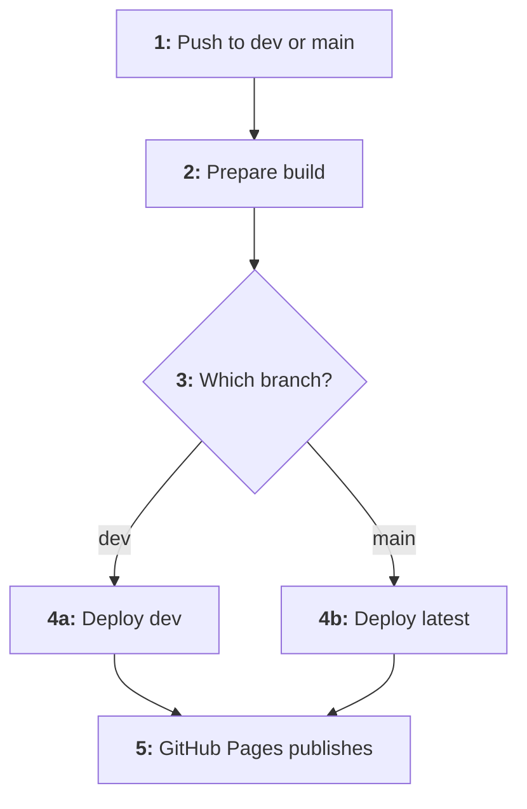

# 0001 - Documentation approach

**Date:** 2026-10-08  
**Code:** `ADR-0001`

## Context

Wishlist consists of separate repositories for the backend API and the web client. Product, architecture and feature knowledge spans both, so it needs a single home that is versioned, reviewable and always up to date.
This documentation was created so each technical decision stays trackable.

## Decision

### Central docs repository

All cross-documentation lives in `wishlist-docs`. Code repositories keep only their own README and setup instructions, and link here.

### Docs as code

Documentation is written in Markdown with Mermaid diagrams and versioned in git. Initially, changes are committed directly to the `dev` branch; pull requests will be introduced once more contributors join. Initial commit goes to main.

### Tooling

MkDocs 1.x with the Material theme builds the site, and mike handles versioning. All tool versions are pinned in `requirements.txt` so builds stay reproducible.

### Document types

We will use *ASD*s and *ADR*s, to answer the following questions: _what?_ and _why?_.

### Structure

```text
wishlist-docs/
├── mkdocs.yml              site configuration
├── requirements.txt        pinned tool versions
└── docs/
    ├── index.md            overview page
    ├── product/            vision, glossary
    ├── asd/                index, feature specs (NNN-name.md)
    ├── architecture/       index, auth, data model, i18n
    ├── adr/                index, decision records (NNNN-name.md)
    ├── operations/         environments, deployment, runbook
    └── contributing/       workflow, writing docs
```

### Continuous delivery with two versions

The branching model is a simplified Git Flow.

- The `main` branch builds **latest**: the production docs and the default version of the site.
- The `dev` branch builds **dev**: work in progress, published alongside `latest` with a banner marking it as the development version.
- Every push to `main` or `dev` is built and deployed automatically by CI. Releases are made by merging `dev` into `main`.

### CI pipeline

The `docs` workflow runs on GitHub Actions and publishes both versions to GitHub Pages.



| #      | Step              | What happens                                                                                       | Runs on       |
| ------ | ----------------- | -------------------------------------------------------------------------------------------------- | ------------- |
| **1**  | **Push**          | A push to `dev` or `main` starts the workflow. Other branches are ignored.                         | `dev`, `main` |
| **2**  | **Prepare build** | A fresh runner checks out the repository and installs the pinned tools from `requirements.txt`.    | `dev`, `main` |
| **3**  | **Branch check**  | The pushed branch decides which version is built.                                                  | `dev`, `main` |
| **4a** | **Deploy dev**    | mike builds the site into the `dev/` folder of the `gh-pages` branch, with the development banner. | `dev`         |
| **4b** | **Deploy latest** | mike builds the site into the `latest/` folder and makes it the default version.                   | `main`        |
| **5**  | **Publish**       | GitHub Pages serves the `gh-pages` branch: the root URL opens `latest`, and `/dev/` opens `dev`.   | `dev`, `main` |

### GitHub wikis

Wikis will be disabled in all Wishlist repositories so the docs site remains the single source of truth.

### Writing conventions (preparing for AI)

- No manual line breaks inside paragraphs or list items; each paragraph is a single line.
- No numbered lists for sections; use `###` headers instead.
- No arrow characters (such as `→` or `->`) in prose; describe the relationship in words. Arrows are allowed only inside Mermaid diagrams and code.
- No em dashes; use a colon, comma, parentheses or a new sentence instead.
- Tables are used only to explain flow diagrams and are placed directly below the diagram they describe. Everything else uses `###` headers and bullet points.
- Each diagram node is numbered in its label (e.g. `1: Push to dev or main`), and the table has exactly one row per node, in the same order.
- The first column (`#`) holds the step number in bold, matching the number in the diagram. Branching steps use letter suffixes (e.g. **8a**, **8b**).
- The second column holds the step name in bold; the remaining columns hold plain-text detail.
- Table cells contain a single line of text: no line breaks, no nested lists.
- Diagram labels use a colon after the number (`1:`), not a period, because Mermaid can misread `1.` as a Markdown list.

## Consequences

- One place to look for product and architecture knowledge, with its full history in git.
- Readers can always see both the released state (`latest`) and upcoming changes (`dev`).
- Code commits that change behavior reference the related ASD in the commit message (e.g. `ASD-002: hide reservations from list owner`), and the matching docs change is committed to `dev` in the docs repository at the same time, or the docs will drift.
- Once pull requests are introduced, feature PRs in the code repositories must link to the matching docs PR.
- MkDocs 1.x is no longer maintained upstream and Material for MkDocs reaches end of life in November 2026. Pinned versions keep the build working in the meantime; migration to Zensical will be evaluated in ADR XXXX.
