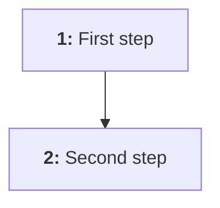

# NNN - Title

**Date:** YYYY-MM-DD  
**Updated:** YYYY-MM-DD  
**Code:** `ASD-NNN`  
**Status:** Draft

!!! todo "Not finalized"
    This page is a draft and may change.

## Why

One or two sentences on the problem this feature solves and who has it.

## User stories

- As a [role], I want [goal] so that [benefit].

## Acceptance criteria

### AC1: Criterion name

- **Given** the starting situation
- **When** the user does something
- **Then** the expected result

### AC2: Criterion name

- **Given** the starting situation
- **When** the user does something
- **Then** the expected result

## Flow

| #     | Step            | What happens                   |
| ----- | --------------- | ------------------------------ |
| **1** | **First step**  | Description of the first step. |
| **2** | **Second step** | Description of the second step.|

## Out of scope

- What this feature deliberately does not cover, for now.

## Open questions

!!! question "Open question"
    Write each open question in its own callout, and remove it once it is answered.

## Related

- Related ADRs: none
- Implemented in: not yet

## Changelog

- YYYY-MM-DD: Initial draft.
