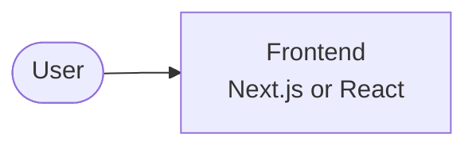

# Wishlist

Documentation for **Wishlist**, a shared wishlist and gift-coordination platform.

## Flowchart example

## Where to start

- **Product**: what we're building and why
- **ASDs**: feature specs
<!-- - **Architecture**: how the pieces fit together -->
- **ADRs**: why we made key decisions
